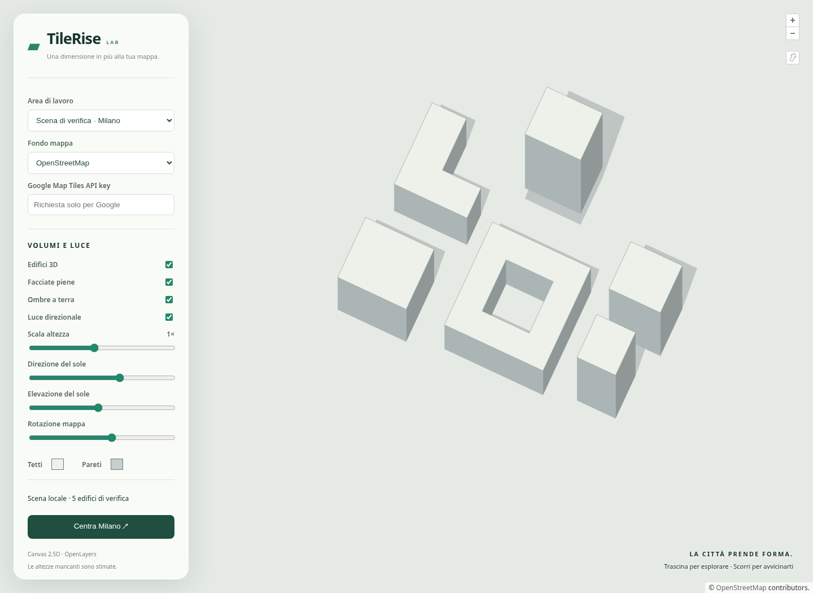

# TileRise

**Lightweight 2.5D buildings for OpenLayers.**

Turn building footprints into solid walls, flat roofs and ground shadows with Canvas 2D. Add a layer to any OpenLayers map and start exploring.



- Loads OpenStreetMap buildings automatically as you explore.
- Works with your own OpenLayers vector source, GeoJSON or MVT data.
- Customizable colors, heights, lighting and shadows. TypeScript included.

## Install

Requires Node.js 22.12+ to build and OpenLayers 10.6+ (v10).

Build and package from this repository:

```sh
npm ci
npm run build
npm pack
```

Then install the generated archive in your application:

```sh
npm install ol@10 /path/to/tilerise-0.1.4.tgz
```

## Quick start

Create a `<div id="map" style="height: 500px"></div>`, then:

```ts
import 'ol/ol.css';
import Map from 'ol/Map.js';
import View from 'ol/View.js';
import { fromLonLat } from 'ol/proj.js';
import TileRise, { createBasemap } from 'tilerise';

new Map({
  target: 'map',
  view: new View({
    center: fromLonLat([9.19, 45.4642]),
    zoom: 18,
  }),
  layers: [createBasemap(), new TileRise()],
});
```

Buildings load automatically when zoomed in. Heights come from the dataset, with estimates when missing. The default provider uses public Overpass; configure your own provider for production.

## Try the demo

```sh
npm ci
npm run dev
```

Open [localhost:5173](http://localhost:5173). Switch to **Edifici reali · OpenStreetMap** to explore real buildings, or use the local test scene to try the rendering controls.

## License

[MIT](LICENSE) · Map data © [OpenStreetMap contributors](https://www.openstreetmap.org/copyright).
